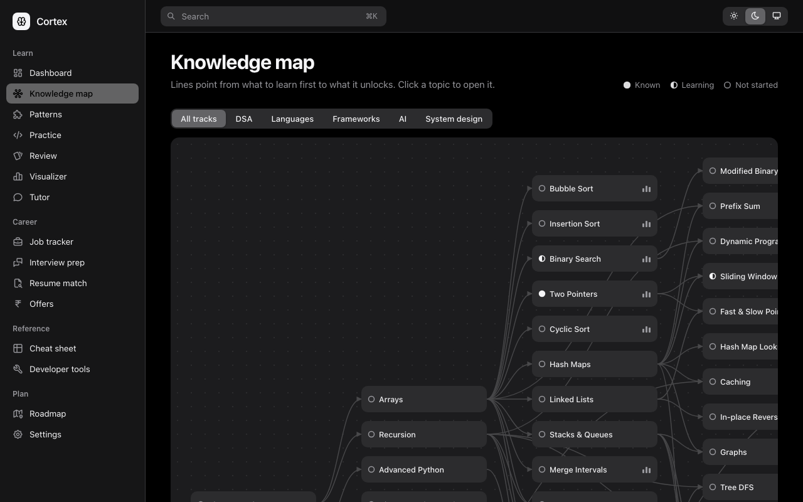
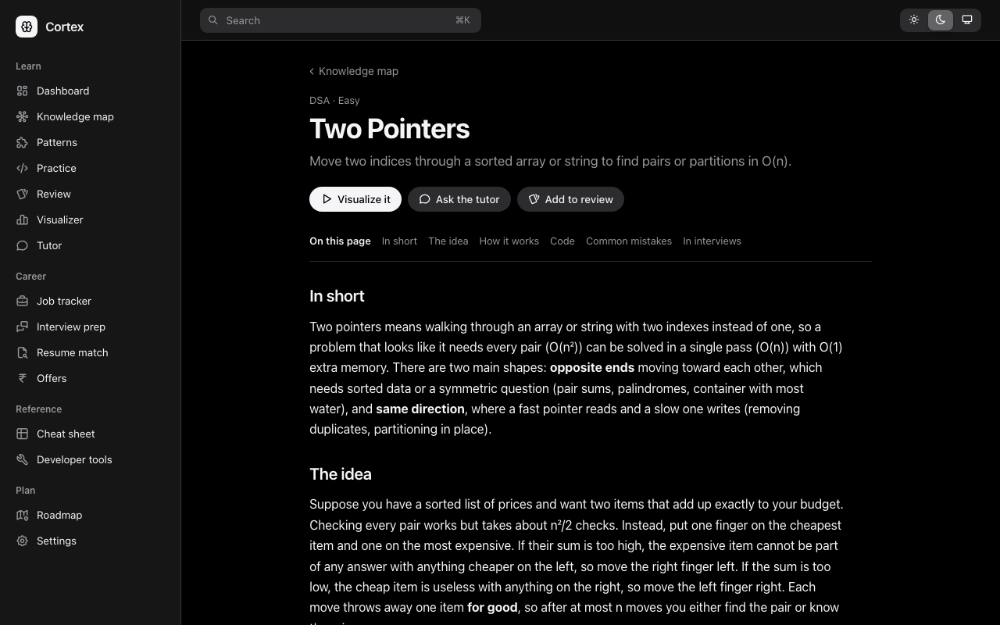
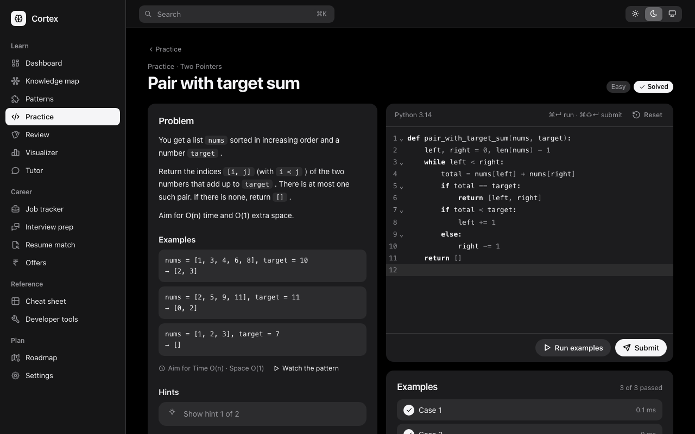
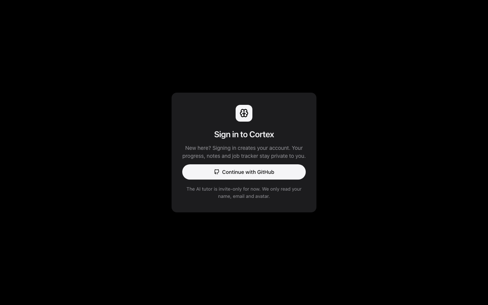
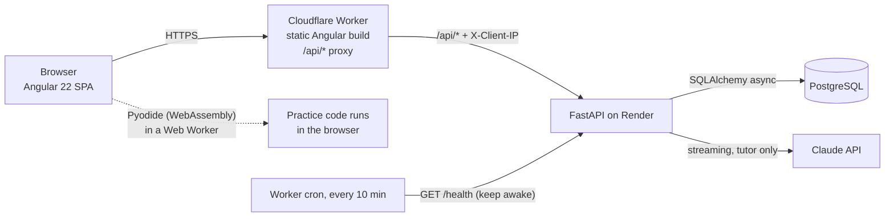

# Cortex

An interactive learning platform for engineers preparing for a job switch: DSA, Python and SQL,
Django, AI and system design, with practice code that runs in your browser and an AI tutor.

[](https://github.com/aayush2694/cortex/actions/workflows/ci.yml)
[](https://github.com/aayush2694/cortex/actions/workflows/codeql.yml)

**Live: [cortex.aayush3783.workers.dev](https://cortex.aayush3783.workers.dev)** (sign in with GitHub)

| Knowledge map | Topic guide |
| --- | --- |
|  |  |
| **Practice, run in the browser** | **Sign-in** |
|  |  |

## What it does

**Learn**
- Knowledge map of 90 topics in 5 tracks, linked by prerequisites and shaded by your mastery
- A written guide for every topic, from a plain-words explanation to code, common mistakes and
  interview questions
- 18 DSA patterns, each with an animated walkthrough, a template and linked LeetCode problems
  (95 in all), plus a step-by-step visualizer for 7 classic algorithms

**Practise**
- 50 coding problems (36 Python, 14 SQL) with hidden tests, hints and solutions, run in the
  browser with Pyodide
- Spaced-repetition flashcards, notes on every topic, a daily plan and an activity heatmap

**Get the job**
- Application board, 54 interview questions for a Python/Django/Angular role, resume-to-job
  match and offer comparison
- AI tutor (Claude) that streams answers, knows the topic and your progress, and gives hints
  first; invite-only, with a daily message limit

**Account**
- Sign in with GitHub (Google is implemented and appears once its credentials are configured);
  export all your data or delete your account
- Light / Dark / Auto themes, ⌘K search, and small developer tools (JSON, regex, JWT, Base64)

## Architecture



The browser talks to one origin. The Worker serves the build and forwards `/api/*` to the API,
and its cron stops Render's free tier from sleeping. The server never runs user code.

The backend is a modular monolith. Each module in `backend/app/modules/` (`topics`, `progress`,
`visualizer`, `practice`, `study`, `jobs`, `tutor`, `users`, `auth`) has the same layers:
`router → service → repository → models`, with `schemas.py` for request and response shapes.
Pure logic lives in I/O-free files (`engine.py`, `matcher.py`, `harness.py`, `catalog.py`) that
unit tests cover directly. `app/clients/llm.py` is the only code that calls Claude.

## Engineering highlights

- **User code never runs on the server.** Pyodide runs it in a Web Worker; the judge
  (`practice/harness.py`) is the same file the backend tests use to check every reference solution.
- **OAuth sign-in with PKCE, single-use state and a browser-binding cookie.** The state row is
  deleted as it is read, and an HttpOnly nonce cookie ties the flow to the browser that started
  it, which blocks login CSRF.
- **Short-lived JWTs with rotating refresh tokens.** A 15-minute access token lives in memory; the
  30-day refresh token is stored only as a hash and rotates on every use. A reused token revokes
  its whole family (with a 10-second grace for two tabs refreshing at once).
- **Per-user data isolation.** Every user-owned table has `user_id` and every repository query
  filters by it; an integration test signs in two users and checks neither sees the other's data.
- **Rate limiting behind a proxy.** Fixed one-minute windows, keyed by user when signed in.
  Per-IP limits apply only when `PROXY_SHARED_SECRET` is set, because without it every visitor
  arrives from the Worker's address and one client could exhaust everyone's bucket.
- **Logs useful for debugging, safe to keep.** Every request gets an id, returned in
  `x-request-id` and in every error body. Logs omit query strings, tokens, cookies, emails and
  bodies, and SQLAlchemy runs with `hide_parameters`; tests assert none of these leak.
- **Strict Content-Security-Policy.** Scripts load only from the site and the Pyodide CDN path;
  a unit test parses `index.html` and fails if the policy loosens.
- **Content tested as code.** Topics, problems and questions are YAML in git, validated at
  startup. Every runnable guide example is executed by the tests, every reference solution must
  pass and every starter must fail, and a weekly CI job opens every external link.

## Tech stack

Versions as declared in `backend/pyproject.toml` and `frontend/package.json`.

- **Backend:** Python ≥3.13, FastAPI ≥0.162, SQLAlchemy ≥2.1.8 (async, asyncpg), Alembic ≥1.20.1,
  Pydantic v2 (pydantic-settings ≥2.16.2), PyJWT ≥2.15.1, Anthropic SDK ≥2.6.0, managed with uv
- **Frontend:** Angular ^22.2.6 (zoneless, standalone, signals), TypeScript ~6.0.2, CodeMirror 6,
  Pyodide 314.0.7
- **Database:** PostgreSQL 18
- **Testing and linting:** pytest ≥9.2, pytest-cov, Vitest ^5.0, Playwright ^1.65.1, ruff, mypy
  (strict)
- **Hosting:** Cloudflare Workers (frontend and proxy), Render (API)

## Quality

- **472 backend tests** (pytest; unit, and integration against a real PostgreSQL with a fake
  Claude client); CI fails if coverage drops below **90%**
- **130 frontend unit tests** in 26 files (Vitest)
- **3 end-to-end tests** (Playwright, Chromium) against a throwaway database: a learner journey
  through map, guide, practice and progress; the sign-in redirect; the API refusing requests
  without a token
- **CI** on every push and pull request, in three jobs: backend (ruff, format, `mypy --strict`,
  migrations up/check/down/up, tests), frontend (unit tests, production build) and e2e
- **CodeQL** (Python, TypeScript, Actions) on every push and weekly; **Dependabot** weekly for
  uv, npm and GitHub Actions; **pre-commit** with ruff and gitleaks secret scanning
- Built test-first: features start from a failing test

## Run it locally

Needs PostgreSQL 18, [uv](https://docs.astral.sh/uv/) and Node.js. Dev mode (`AUTH_MODE=dev`,
the default in `.env.example`) uses one local user, so there is no sign-in.

```bash
brew services start postgresql@18
createdb cortex && createdb cortex_test

cd backend
cp .env.example .env          # set DATABASE_URL to your Postgres user
uv sync && uv run alembic upgrade head
uv run fastapi dev app/main.py                  # API and docs at http://localhost:8000/docs
```

In a second terminal:

```bash
cd frontend
npm install && npx ng serve                     # http://localhost:4200, proxies /api to :8000
```

Add `ANTHROPIC_API_KEY` to `backend/.env` to turn on the AI tutor. Tests:
`cd backend && uv run pytest --cov` and `cd frontend && npx ng test --watch=false`.

## Project structure

```
backend/
  app/core/          config, database, errors, logging, auth, rate limiting
  app/clients/       llm.py, the only Claude caller
  app/modules/       one folder per feature (router → service → repository → models)
  content/           topics, problems, interview questions (YAML) and 90 Markdown guides
  tests/             unit/ (no I/O) and integration/ (real database)
frontend/
  src/app/           core/, layout/, shared/, features/<page>/
  public/            pyodide-worker.js
  e2e/               Playwright tests
  worker.js          Cloudflare Worker (proxy and keep-awake cron)
docs/                system design, deployment, screenshots
```

More detail:
[backend](backend/README.md) ·
[frontend](frontend/README.md) ·
[system design](docs/system-design/README.md) ·
[deploying sign-in](docs/deploy-sign-in.md)

## Roadmap

Planned work is tracked in [aayush2694/cortex-roadmap](https://github.com/aayush2694/cortex-roadmap).

## Author

Built by Aayush Pal · [github.com/aayush2694](https://github.com/aayush2694)
