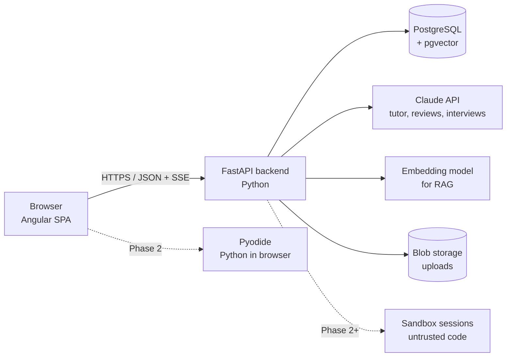

# 01 — Overview

## What Cortex is

Cortex is an interactive learning platform for people preparing to switch jobs in software. It covers four tracks — **DSA**, **programming languages**, **AI/ML**, and **system design** — and every concept is something you can *play with*, not just read. An AI tutor knows what you have learned and where you are weak.

## Goals

1. **Interactive first.** Every core concept has a visual, hands-on component (step-through algorithms, live simulations, runnable code).
2. **Personal.** The platform tracks mastery per topic and adapts: what to study next, what to review, where the gaps are for a target job.
3. **AI that teaches, not answers.** The tutor gives hints and asks questions before it gives solutions.
4. **Job-switch oriented.** Everything connects back to "am I ready for this role?"
5. **Production-grade engineering.** Real cloud deployment (Azure), CI/CD, tests, monitoring — the codebase itself is a portfolio piece.

## Non-goals (for now)

- Video courses or a content marketplace
- Social features (forums, followers)
- Mobile apps (the web app should still work on phones)
- Supporting thousands of concurrent users on day one (design for it, don't pay for it)

## Users

| User | Needs |
|---|---|
| **Learner** (primary — you) | Learn topics interactively, track progress, practise, prepare for interviews |
| **Visitor / recruiter** | See a live demo that works without signing up |
| **Admin** (you) | Add topics and content, watch costs and errors |

## High-level architecture

**Split of responsibilities**

- **Angular frontend (TypeScript)** — everything the user sees: pages, animations, the knowledge-map graph, the chat window. It holds no business logic beyond presentation.
- **FastAPI backend (Python)** — all logic: algorithm tracing, learning engine, AI orchestration, RAG, persistence, auth checks.
- **PostgreSQL + pgvector** — one database for relational data *and* vector search, so there is one system to run and back up.
- **Claude API** — language-model work: tutoring, design reviews, mock interviews, JD analysis.

## Main modules

| Module | Phase | Summary |
|---|---|---|
| Knowledge map | 1 | Graph of all topics with prerequisites, coloured by your mastery |
| DSA visualizer | 1 | Python runs the algorithm and records every step; the browser plays the steps back |
| AI tutor | 1 | Streaming chat that knows your progress and the topic you are on |
| Cloud deployment | 2 | Live on Azure with CI/CD, monitoring, auth |
| Notes + RAG | 3 | Your own notes become searchable context for the tutor |
| Spaced repetition | 3 | Quiz cards scheduled just before you would forget |
| Code sandbox | 3 | Run Python in the browser; later, other languages server-side |
| System design playground | 3 | Drag components, send simulated traffic, see bottlenecks |
| Job switch engine | 4 | JD gap analysis, personal roadmap, mock interviewer, readiness score |
| AI concepts lab | 5 | Interactive explainers for tokens, embeddings, attention, RAG |
| MCP server | 5 | Lets Claude Desktop quiz you using your Cortex data |

## Quality targets

| Concern | Target |
|---|---|
| Page load (first visit) | < 2 s on broadband |
| API latency (non-AI endpoints) | p95 < 200 ms |
| Tutor first token | < 3 s |
| Availability | 99.5% (single region is fine) |
| Monthly cloud cost (dev) | < $10, with a budget alert |
