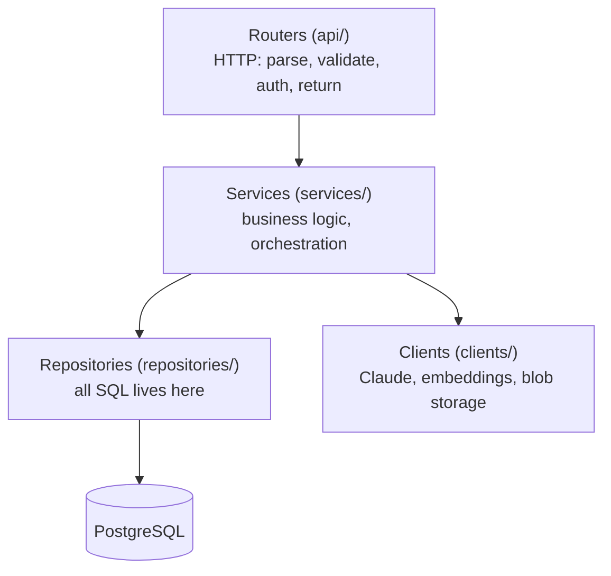
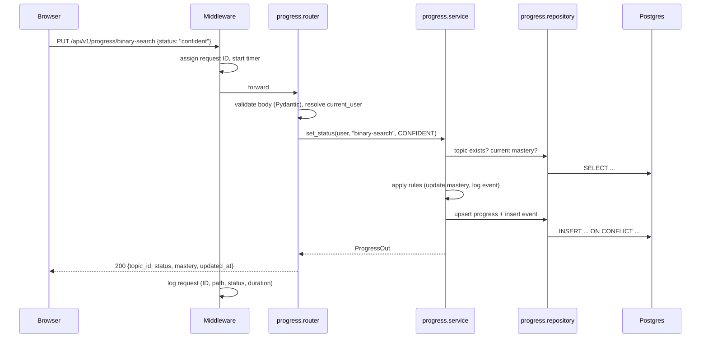

# 02 — Backend Architecture

The backend is a **Python 3.13+ FastAPI** application organised as a **modular monolith**: one deployable service, split internally into feature modules with clear boundaries. This keeps deployment simple while leaving a clean path to split a module out later if it needs to scale on its own.

## Why a modular monolith (not microservices)

- One developer, one deployable: microservices would add networking, deployment and debugging cost with no benefit yet.
- Clear module boundaries give most of the design benefit. Each module owns its tables and talks to others only through its service layer.
- If one module grows heavy (e.g. the simulator), it can become its own service without rewriting the others.

## Layers

Every request flows through the same four layers. Each layer only calls the one below it.



| Layer | Knows about | Never does |
|---|---|---|
| **Routers** | HTTP, request/response schemas, auth dependency | SQL, calling Claude directly |
| **Services** | Domain rules, which repositories/clients to call | HTTP details (status codes, headers) |
| **Repositories** | SQLAlchemy models and queries | Business rules |
| **Clients** | One external system each (Claude, embeddings, storage) | Database access |

This makes every service testable with fake repositories and fake clients — no network or database needed for unit tests.

## Folder structure

```
backend/
├── pyproject.toml
├── alembic/                    # database migrations
├── app/
│   ├── main.py                 # create app, register routers, middleware
│   ├── core/
│   │   ├── config.py           # settings from env vars (pydantic-settings)
│   │   ├── db.py               # async engine + session dependency
│   │   ├── auth.py             # current_user dependency (dev user → Entra ID later)
│   │   ├── errors.py           # error types + consistent JSON error responses
│   │   └── logging.py          # structured logs, request IDs
│   ├── modules/
│   │   ├── topics/             # knowledge map: topics + prerequisite edges
│   │   │   ├── router.py
│   │   │   ├── service.py
│   │   │   ├── repository.py
│   │   │   ├── models.py       # SQLAlchemy tables
│   │   │   └── schemas.py      # Pydantic request/response models
│   │   ├── progress/           # mastery per topic, activity events
│   │   ├── visualizer/         # algorithm tracers (pure Python, no DB)
│   │   │   └── tracers/        # sorting.py, searching.py, graphs.py, ...
│   │   ├── tutor/              # chat sessions, prompt assembly, streaming
│   │   ├── notes/              # Phase 3: notes + chunking + embeddings
│   │   ├── reviews/            # Phase 3: spaced repetition cards
│   │   ├── simulator/          # Phase 3: system design simulation
│   │   └── career/             # Phase 4: JD analysis, interviews, readiness
│   └── clients/
│       ├── llm.py              # Claude wrapper: streaming, retries, refusals
│       ├── embeddings.py       # embedding provider wrapper
│       └── storage.py          # local disk (dev) / Azure Blob (prod)
├── content/                    # topic catalogue as YAML (versioned in git)
└── tests/
    ├── unit/                   # services + tracers, no I/O
    └── integration/            # API tests against a real test database
```

## Key libraries

| Need | Library | Why |
|---|---|---|
| Web framework | **FastAPI** | Async, automatic OpenAPI docs, Pydantic validation |
| Validation / schemas | **Pydantic v2** | Fast, typed, shared with FastAPI |
| Settings | **pydantic-settings** | Typed config from environment variables |
| ORM | **SQLAlchemy 2 (async)** | Industry standard, typed queries |
| Migrations | **Alembic** | Versioned schema changes |
| DB driver | **asyncpg** | Fast async Postgres driver |
| Vectors | **pgvector** (Python package + Postgres extension) | Vector search inside Postgres |
| LLM | **anthropic** (official SDK) | Claude API with streaming |
| Testing | **pytest**, **httpx** | Unit and API tests |
| Lint / format / types | **ruff**, **mypy** | One fast linter + type checks in CI |
| Package manager | **uv** | Fast installs, lock file |

## Request lifecycle (example: save progress)



## Streaming (AI tutor)

Tutor replies stream token by token using **Server-Sent Events (SSE)**: a normal HTTP response that stays open and sends `data:` lines. It is simpler than WebSockets, works through proxies and Azure ingress, and Angular can read it with `fetch` + a stream reader.

```
POST /api/v1/tutor/sessions/{id}/messages   →   text/event-stream
event: delta   data: {"text": "Binary search works by..."}
event: delta   data: {"text": " halving the range..."}
event: done    data: {"message_id": "...", "usage": {...}}
```

See [06 — AI Tutor & RAG](06-ai-tutor-and-rag.md) for what happens inside.

## Configuration

All configuration comes from environment variables (12-factor style). Locally they are read from a `.env` file that is **never committed**; in Azure they come from Container Apps settings backed by **Key Vault**.

| Variable | Example | Notes |
|---|---|---|
| `DATABASE_URL` | `postgresql+asyncpg://...` | |
| `ANTHROPIC_API_KEY` | — | Secret. Key Vault in prod |
| `TUTOR_MODEL` | `claude-opus-5-5` | Model can change without code changes |
| `CORS_ORIGINS` | `http://localhost:4200` | Angular dev server |
| `AUTH_MODE` | `dev` / `entra` | `dev` = single local user, no login |
| `STORAGE_BACKEND` | `local` / `azure` | |

## Error handling

Every error returns the same JSON shape so the frontend can handle it in one place:

```json
{ "error": { "code": "topic_not_found", "message": "No topic with id 'heapsort'", "request_id": "c1f3..." } }
```

Domain errors (`NotFound`, `Conflict`, `ValidationFailed`, `AIUnavailable`) are raised in services and mapped to HTTP status codes in one exception handler in `core/errors.py`.

## Testing strategy

| Level | What | Speed |
|---|---|---|
| Unit | Tracers (every frame valid, final state correct), learning-engine maths, prompt assembly | ms |
| Integration | API endpoints against a real Postgres test DB (created per test run) | seconds |
| Contract | OpenAPI schema snapshot — fails if the API changes by accident | ms |
| AI evals | Small set of tutor prompts graded for "hints before answers" (Phase 3) | minutes, run manually |

CI (GitHub Actions) runs lint, type checks, unit and integration tests on every push.

## Local development setup

| Component | How it runs locally |
|---|---|
| API | `uv run fastapi dev` on `http://localhost:8000` (auto-reload) |
| Database | PostgreSQL 18 via Homebrew (pgvector arrives with RAG in Phase 3) |
| Frontend | `ng serve` on `http://localhost:4200` |
| API docs | Auto-generated at `http://localhost:8000/docs` |
