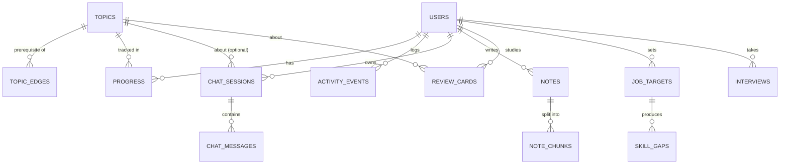

# 03 — Data Model

One **PostgreSQL** database holds everything. The **pgvector** extension adds a `vector` column type for embeddings, so RAG search runs in the same database as everything else.

## Entity overview

## Tables by phase

### Phase 1 — core

**`users`**
| Column | Type | Notes |
|---|---|---|
| `id` | uuid PK | |
| `external_id` | text unique | Subject ID from Entra ID (null for the dev user) |
| `display_name` | text | |
| `created_at` | timestamptz | |

**`topics`** — the knowledge-map nodes. Loaded from `content/*.yaml` at startup (content lives in git; the table is a cache for querying).
| Column | Type | Notes |
|---|---|---|
| `id` | text PK | Slug, e.g. `binary-search` |
| `track` | text | `dsa` · `languages` · `frameworks` · `ai` · `system-design` |
| `title` | text | |
| `summary` | text | One or two sentences |
| `difficulty` | smallint | 1–5 |
| `visualizer` | text null | Tracer key if the topic has a visualizer, e.g. `binary_search` |
| `phase` | smallint | Roadmap phase where the topic's interactive content ships |
| `resources` | jsonb | Links to official docs, e.g. `[{"label": "Models", "url": "https://docs.djangoproject.com/..."}]` |

**`topic_edges`** — prerequisites (a directed acyclic graph).
| Column | Type | Notes |
|---|---|---|
| `from_topic` | text FK → topics | The prerequisite |
| `to_topic` | text FK → topics | The topic that needs it |
| PK | (`from_topic`, `to_topic`) | |

**`progress`** — one row per user per topic.
| Column | Type | Notes |
|---|---|---|
| `user_id` | uuid FK | |
| `topic_id` | text FK | |
| `status` | text | `not_started` · `learning` · `confident` |
| `mastery` | real | 0.0–1.0, computed by the learning engine |
| `last_activity_at` | timestamptz | |
| PK | (`user_id`, `topic_id`) | |

**`activity_events`** — append-only log; mastery is computed from it.
| Column | Type | Notes |
|---|---|---|
| `id` | bigserial PK | |
| `user_id`, `topic_id` | | |
| `kind` | text | `visualizer_completed`, `status_set`, `quiz_answered`, `tutor_question`, ... |
| `payload` | jsonb | Event-specific data (e.g. quiz grade) |
| `created_at` | timestamptz | Indexed with `user_id` |

**`chat_sessions`** / **`chat_messages`**
| Column | Type | Notes |
|---|---|---|
| `chat_sessions.id` | uuid PK | |
| `chat_sessions.user_id` | uuid FK | |
| `chat_sessions.topic_id` | text FK null | Topic the chat was opened from |
| `chat_messages.id` | uuid PK | |
| `chat_messages.session_id` | uuid FK | Indexed |
| `chat_messages.role` | text | `user` · `assistant` |
| `chat_messages.content` | jsonb | Full content blocks as returned by the API (needed to replay history correctly) |
| `chat_messages.input_tokens`, `output_tokens` | int | For cost tracking |
| `chat_messages.created_at` | timestamptz | |

### Phase 3 — notes, RAG, reviews

**`notes`** — Markdown notes written by the user (`id`, `user_id`, `topic_id` null, `title`, `body`, `updated_at`).

**`note_chunks`** — notes split into ~400-token pieces for retrieval.
| Column | Type | Notes |
|---|---|---|
| `id` | uuid PK | |
| `note_id` | uuid FK (cascade delete) | |
| `user_id` | uuid | Denormalised so every vector query filters by user cheaply |
| `chunk_index` | int | |
| `text` | text | |
| `embedding` | vector(N) | N depends on the embedding model (see doc 06) |
| `tsv` | tsvector | For keyword search (hybrid retrieval) |

Indexes: HNSW index on `embedding` (cosine), GIN index on `tsv`, b-tree on `user_id`.

**`review_cards`** — spaced-repetition flashcards (`id`, `user_id`, `topic_id`, `front`, `back`, `source` (`generated` · `manual`), `stability`, `difficulty`, `due_at`, `last_review_at`, `reps`, `lapses`). The scheduling fields follow the FSRS algorithm (doc 07).

### Phase 4 — career

**`job_targets`** — a pasted job description and its parsed form (`id`, `user_id`, `title`, `company`, `raw_text`, `parsed` jsonb, `created_at`).

**`skill_gaps`** — one row per required skill per job target (`job_target_id`, `skill`, `topic_ids` text[], `required_level`, `current_level`, `priority`).

**`interviews`** — mock interview sessions (`id`, `user_id`, `kind` (`dsa` · `system_design` · `behavioral`), `transcript` jsonb, `scores` jsonb, `feedback` text, `created_at`).

## Design notes

- **Content in git, not the database.** Topics are authored as YAML so they are reviewable in pull requests and versioned. On startup the backend syncs YAML → `topics`/`topic_edges`.
- **Event log + derived state.** `activity_events` is the source of truth; `progress.mastery` is a cached result. If the mastery formula changes, recompute it from events.
- **Every user-owned table has `user_id`.** Every query filters by it — this is the main data-isolation guarantee.
- **UUIDs for user-facing IDs** so IDs can't be guessed or counted.
- **Migrations** with Alembic; every schema change is a reviewed migration file.
