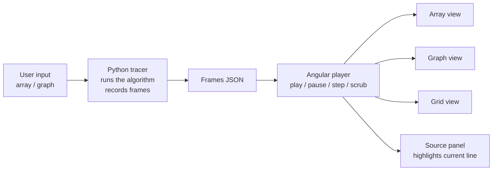

# 05 — DSA Visualizer

## Idea

The algorithm runs as **real Python code on the backend**. While it runs, it records a **frame** at every interesting moment (compare, swap, visit a node, ...). The browser receives the list of frames and plays them like a video: play, pause, step forward, step back, change speed.



## Why trace on the backend

| Option | Pros | Cons |
|---|---|---|
| **Trace in Python (chosen)** | Algorithm code is real, readable Python that learners study; one language for all logic; easy to unit-test | One API call per run (fast — algorithms on small inputs run in microseconds) |
| Animate directly in JS | No server call | Algorithms written twice (JS for animation, Python for learning); logic mixed into UI code |

Stepping backward is free with frames: the player just shows the previous frame. No "undo" logic needed.

## Frame format

Every tracer returns the same envelope; only `state` differs per view.

```json
{
  "line": 4,
  "state": { "array": [3, 1, 4, 1, 5], "sorted_from": 3 },
  "highlight": [1, 2],
  "action": "compare",
  "message": "Compare 1 and 4",
  "counters": { "comparisons": 5, "swaps": 2 }
}
```

| Field | Meaning |
|---|---|
| `line` | Line in `source` to highlight (1-based) |
| `state` | Full snapshot needed to draw this frame (view-specific) |
| `highlight` | Indices or node IDs to emphasise |
| `action` | `compare` · `swap` · `set` · `visit` · `relax` · `found` · `done` — the UI colours by action |
| `message` | One plain-English sentence explaining the step |
| `counters` | Running totals shown next to the animation |

**Full snapshots, not diffs.** Inputs are small (≤ 64 array items, ≤ 30 graph nodes), so each frame carries the whole state. This makes scrubbing to any frame trivial. A run produces at most a few thousand frames (< 1 MB).

## Tracer design (Python)

```python
class Tracer:
    """Collects frames while an algorithm runs."""
    def __init__(self, source_lines: list[str]): ...
    def frame(self, line: int, state: dict, action: str,
              message: str, highlight: list = ()) -> None: ...

TRACERS: dict[str, TracerSpec] = {}   # registry: key → (function, view, input schema, limits)

@register("bubble_sort", view="array", input=ArrayInput, max_len=32)
def bubble_sort(arr: list[int], t: Tracer) -> list[int]:
    ...
```

- Each algorithm is a normal function that also calls `t.frame(...)` at key points.
- The `source` shown in the UI is a clean version of the function **without** the tracing calls, stored next to it, so learners read textbook code.
- A registry maps algorithm keys to functions, views and input limits, so adding an algorithm = one new function + one test.

## Phase 1 algorithms

| Algorithm | View | Key frames |
|---|---|---|
| Bubble sort | array | compare, swap, mark sorted |
| Insertion sort | array | pick key, shift, insert |
| Merge sort | array (+ split depth) | split, compare, merge write |
| Quick sort | array | choose pivot, partition compare, swap, pivot placed |
| Binary search | array | lo/hi/mid, discard half, found |
| BFS on grid | grid | enqueue, visit, path found |
| Dijkstra | graph | pick min, relax edge, finalise node |

Later: heaps, BST insert/delete, union-find, DP tables (LCS, knapsack), topological sort, tries.

## Safety limits

- Input size capped per algorithm (validated by Pydantic before running).
- Frame count capped (e.g. 5,000) — tracer stops and returns an error frame if exceeded.
- Phase 1 runs **only our own** algorithms. Visualising *user-written* code is a Phase 3 feature that needs a safe code sandbox.

## Testing

For every tracer:
1. Final state is correct (e.g. result equals `sorted(input)`) — checked with many random inputs.
2. Every frame validates against the frame schema.
3. `line` always points to a real line of `source`.
4. Edge cases: empty input, one item, duplicates, already sorted, reverse sorted.
