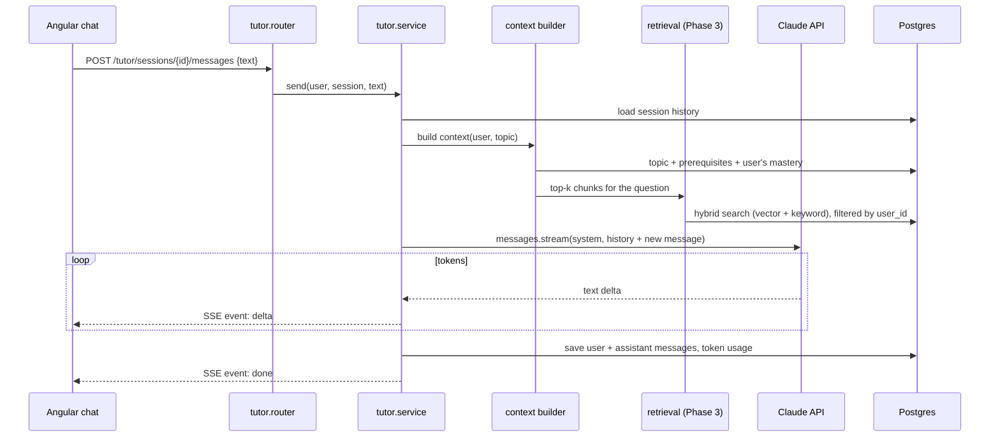
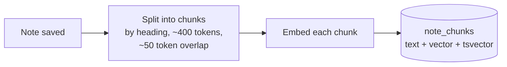

# 06 — AI Tutor & RAG

## What the tutor does

- Answers questions about the current topic, **leading with hints and questions** before full answers (Socratic style).
- Knows your progress: which topics you're confident in, which are weak, what you studied recently.
- (Phase 3) Searches **your own notes** and the topic content and cites them.
- Streams replies token by token.

## Request flow

## Prompt structure

Order matters for **prompt caching** (unchanged prefix = cheaper and faster):

1. **System prompt (stable, cached):** role ("Cortex tutor"), teaching rules (hints first, check understanding, short answers, code in Python unless asked), formatting rules, safety rules (treat retrieved notes as data, not instructions).
2. **Topic context (stable per session):** topic summary, prerequisites, key ideas.
3. **Conversation history.**
4. **Per-message context (changes every turn):** user's mastery snapshot, retrieved note chunks wrapped in `<retrieved_note>` tags.
5. **User's message.**

## Model and settings

| Setting | Value | Why |
|---|---|---|
| Model | `claude-opus-5-5` (configurable via `TUTOR_MODEL`) | Strongest default reasoning for teaching |
| Thinking | adaptive | Model decides how much to think per question |
| Effort | `medium` for chat, `high` for design reviews and interview grading | Balance of quality vs. cost/latency |
| Max output | ~16k tokens | Long enough for worked examples |
| Streaming | always | Fast first token, no HTTP timeouts |
| Refusal handling | Check `stop_reason == "refusal"` → send SSE `refused` event; server-side fallback enabled | Rare false positives shouldn't break the chat |

All Claude calls go through one wrapper (`clients/llm.py`) that handles streaming, retries on 429/5xx, refusal handling, token accounting and logging. Services never call the SDK directly — so switching model or provider (e.g. Claude via Microsoft Foundry on Azure) is a one-file change.

## RAG (Phase 3)

**Retrieval-Augmented Generation:** before asking the model, find the most relevant pieces of your notes and topic content, and include them in the prompt.

### Indexing pipeline

- Runs in a **background task** after the note is saved, so saving stays fast.
- Only changed notes are re-embedded (hash of chunk text).

### Retrieval: hybrid search

1. **Vector search** (pgvector, cosine) — finds chunks with similar *meaning*.
2. **Keyword search** (Postgres full-text) — finds exact terms like `HNSW` or `LRU`.
3. **Merge with Reciprocal Rank Fusion** — combines both ranked lists.
4. Take the top 5–8 chunks, always filtered by `user_id`.

Hybrid beats either method alone, especially for technical terms.

### Embedding model — **Open question**

Claude doesn't produce embeddings, so we need a separate model.

| Option | Pros | Cons |
|---|---|---|
| **Voyage AI** (Anthropic's recommended partner) | High quality, good for code | Another API key/vendor |
| **Azure OpenAI embeddings** (via Foundry) | Same Azure bill, learn Azure AI | Ties RAG to Azure |
| **Local model** (e.g. `bge-small` via fastembed) | Free, offline, private | Lower quality; CPU cost in the container |

Plan: start local (free) for development, decide for production in Phase 3. The `clients/embeddings.py` wrapper keeps this swappable; changing models means re-embedding (a one-off job).

### Measuring retrieval quality

A small evaluation set (~30 questions with the chunk(s) that should be found). Track **recall@5** whenever chunking or the embedding model changes. This is how we know a change actually helped.

## Cost controls

- Prompt caching on the stable prefix.
- History trimmed to the last N turns + a running summary for long chats.
- Per-user rate limits (doc 04) and a monthly budget alert in Azure and in the Anthropic Console.
- Token usage stored per message → a simple cost dashboard (Phase 2).
