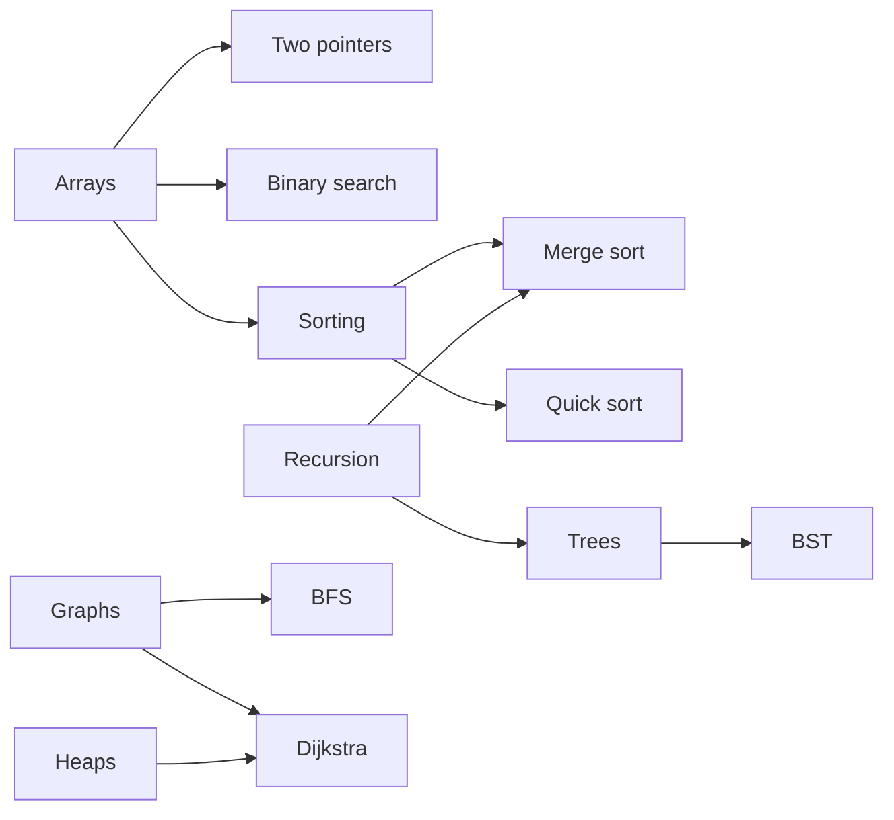

# 07 — Learning Engine

The learning engine turns activity into three things: a **mastery score** per topic, a **"what next?"** recommendation, and a **review schedule**.

## Knowledge map

Topics form a **directed acyclic graph (DAG)**: an edge `A → B` means "learn A before B".

- Authored in `content/*.yaml` and validated on startup: unknown IDs and **cycles** fail the build (cycle check via topological sort).
- The frontend draws it with a force-directed / layered graph layout, coloured by mastery.

## Mastery score (0.0 – 1.0)

Phase 1 uses a simple, explainable formula from activity events:

| Signal | Weight |
|---|---|
| Self-reported status (`learning` = 0.3, `confident` = 0.7) | base |
| Completed the topic's visualizer | + 0.1 |
| Quiz/review accuracy on the topic (Phase 3) | up to + 0.3 |
| Time decay: no activity for a long time | slowly pulls the score down |

Score is clamped to [0, 1] and shown as a colour (red < 0.4 ≤ yellow < 0.7 ≤ green). Because events are stored, the formula can be improved later and recomputed.

## "What next?" recommendation

1. **Unlocked topics:** all prerequisites have mastery ≥ 0.6.
2. **Score** each unlocked topic: `priority = importance_for_target_role × (1 − mastery) + small bonus if it unlocks many other topics`.
3. Return the top 3, with a one-line reason ("Unlocks Dijkstra and Prim's").

`importance_for_target_role` is 1.0 for everyone until Phase 4 adds job targets.

## Spaced repetition (Phase 3)

Flashcards are scheduled with **FSRS** (Free Spaced Repetition Scheduler), the modern successor to the SM-2 algorithm used by older Anki versions. Each card has a *stability* (how long until you'd likely forget) and *difficulty*; grading a card (again / hard / good / easy) updates both and sets the next `due_at`. The open-source `fsrs` Python package implements it.

> **As built:** a simplified **SM-2** (`backend/app/modules/study/engine.py`), not FSRS. It's a few dozen lines with no dependency and predictable intervals: *again* brings a card back in 10 minutes, *good* goes 1 day → 3 days → interval × ease, *hard* and *easy* adjust the ease. FSRS stays a possible upgrade once there's enough review history to fit its parameters.

Cards come from two places: written by you, or **generated by AI** from a topic (reviewed by you before they go into the deck).

## Why this matters for the resume

The engine is plain, well-tested Python (graph algorithms, scoring, scheduling) — good interview material: "I used topological sort to validate the curriculum and an SM-2 scheduler for reviews."
